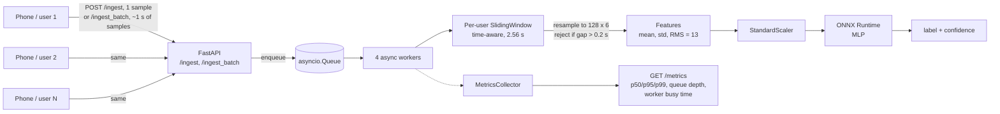
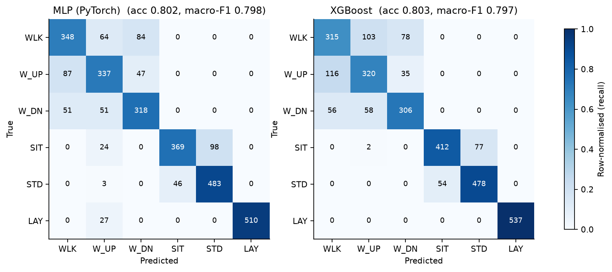
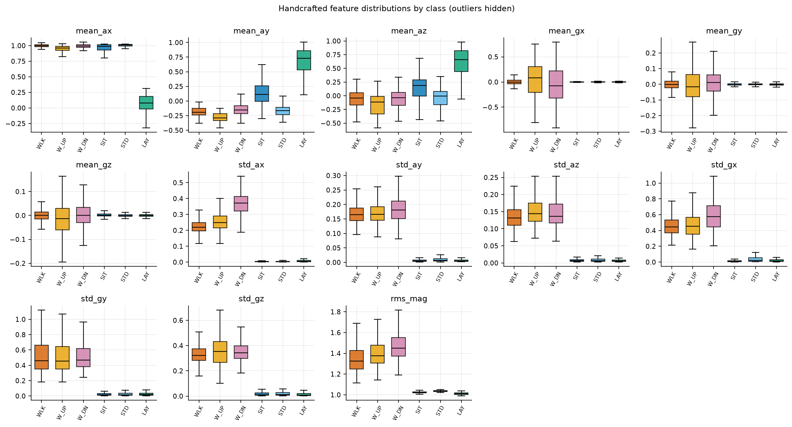
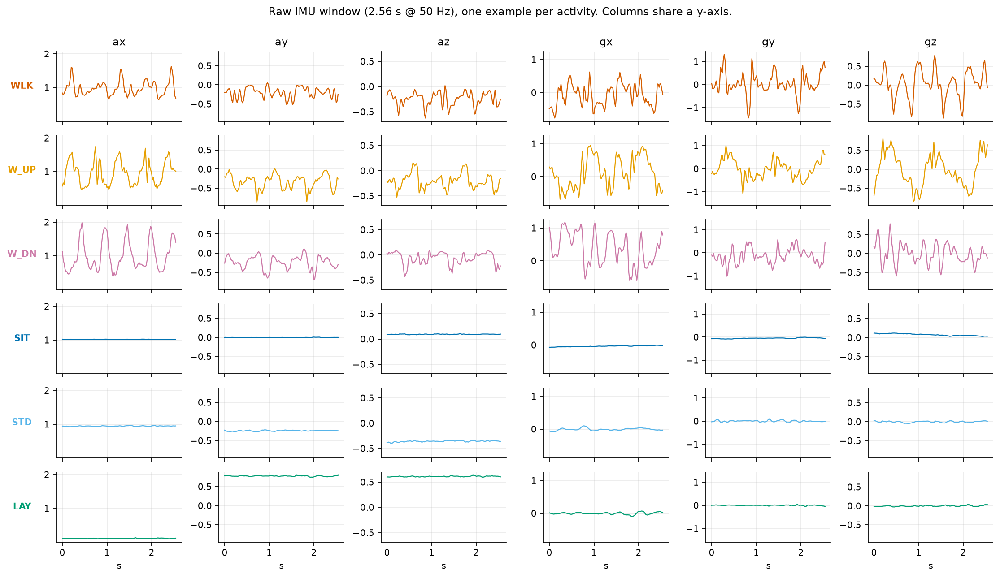

# Real-time Human Activity Recognition service

Streaming activity classification (walking, upstairs, downstairs, sitting, standing, laying) from smartphone accelerometer + gyroscope data, served with FastAPI and ONNX Runtime. Trained on the [UCI HAR dataset](https://archive.ics.uci.edu/dataset/240/human+activity+recognition+using+smartphones) (30 subjects, 50 Hz, 6 channels).

The model is the easy part. This repo is about the serving path: handling irregular real-world sample timing, measuring latency under concurrent users, and comparing runtimes honestly.

## Architecture



Both endpoints only validate and enqueue, so request handling never waits on inference. Workers pull items, update that user's buffer, and run inference once the buffer holds a full valid window. `/ingest` takes one sample per request; `/ingest_batch` takes a block of samples with their capture timestamps.

## Results

### Model accuracy

The test set is the UCI held-out subjects, so these numbers are across unseen people.

<!-- EVAL:START -->
| Class | MLP F1 | XGBoost F1 | Both models wrong |
|---|---:|---:|---:|
| WALKING | 0.7088 | 0.6409 | 123/496 (24.8%) |
| WALKING_UPSTAIRS | 0.6899 | 0.6709 | 93/471 (19.8%) |
| WALKING_DOWNSTAIRS | 0.7319 | 0.7294 | 80/420 (19.1%) |
| SITTING | 0.8146 | 0.861 | 65/491 (13.2%) |
| STANDING | 0.8679 | 0.8795 | 32/532 (6.0%) |
| LAYING | 0.9742 | 1.0 | 0/537 (0.0%) |
| **Overall** | acc 0.8025, macro-F1 0.7979 | acc 0.8035, macro-F1 0.797 | 13.34% of test windows |
<!-- EVAL:END -->

Confusion matrices (counts annotated, colour = row-normalised recall):



### Runtime benchmark

Single-sample (batch size 1) inference, CPU, to mimic streaming. Each runtime is warmed up, then timed over 2000 calls. Macro-F1 is computed on the full test set with that same runtime.

<!-- BENCH:START -->
| Runtime | Size (KB) | p50 (ms) | p95 (ms) | p99 (ms) | Throughput (/s) | Macro-F1 |
|---|---:|---:|---:|---:|---:|---:|
| MLP, PyTorch | 77.2 | 0.0447 | 0.073 | 0.1458 | 20208.8 | 0.7979 |
| MLP, ONNX fp32 | 75.9 | 0.0096 | 0.0117 | 0.0167 | 85416.7 | 0.7979 |
| MLP, ONNX int8 (dynamic PTQ) | 22.7 | 0.0145 | 0.0172 | 0.0339 | 45444.6 | 0.7978 |
| XGBoost, native | 3510.7 | 0.5186 | 0.727 | 0.9222 | 1845.7 | 0.797 |
| XGBoost, ONNX | 1542.3 | 0.0272 | 0.0363 | 0.0517 | 35455.1 | 0.797 |
<!-- BENCH:END -->

### Load test

N simulated phones each produce 50 samples/s for 60 s against one server process. Every row uses a fresh server, so the counters never mix between runs. There are two kinds of row:

- **1 (per-sample):** one `POST /ingest` per sample, and a prediction after every sample.
- **50 (infer per batch):** one `POST /ingest_batch` per second per phone, and one prediction per request. This makes 50x fewer predictions than the per-sample mode, so compare the two on samples/s, not on work done.

Columns: **Rate/user** is the samples actually delivered per user per second (50 means the server kept up). **Windows/s** is predictions made per second. **Inference** is the ONNX call alone. **End-to-end** is enqueue to prediction finished, on the server: queue wait, windowing, interpolation, features and ONNX. It does not include the up to one second a phone spends collecting a batch. **Worker busy (sum)** is the share of the single event loop spent in worker code; the rest is HTTP handling and other event-loop work. **Drop rate** is the share of windows rejected because of a timestamp gap larger than 0.2 s.

<!-- LOAD:START -->
| Mode (samples/req) | Users | Rate/user | Samples/s | Req/s | Windows/s | Inference p99 (ms) | End-to-end p50 / p99 (ms) | Max queue | Worker busy (sum) | Drop rate |
|---|---:|---:|---:|---:|---:|---:|---:|---:|---:|---:|
| 1 (per-sample) | 40 | 39.98 Hz | 1599.4 | 1599.4 | 1514.2 | 0.468 | 7.079 / 16.29 | 25 | 0.682 | 0.0 |
| 1 (per-sample) | 60 | 29.8 Hz | 1787.9 | 1787.9 | 1643.6 | 0.434 | 9.313 / 19.601 | 34 | 0.672 | 0.0102 |
| 1 (per-sample) | 80 | 23.09 Hz | 1847.0 | 1847.0 | 1677.1 | 0.499 | 12.756 / 29.699 | 50 | 0.662 | 0.0 |
| 1 (per-sample) | 100 | 19.23 Hz | 1923.4 | 1923.5 | 1713.3 | 0.477 | 15.27 / 31.447 | 63 | 0.652 | 0.0 |
| 50 (infer per batch) | 40 | 50.0 Hz | 2000.0 | 40.0 | 38.7 | 1.136 | 2.012 / 3.417 | 0 | 0.06 | 0.0 |
| 50 (infer per batch) | 200 | 50.0 Hz | 10000.0 | 200.0 | 193.3 | 1.16 | 1.593 / 3.09 | 0 | 0.247 | 0.0 |
| 50 (infer per batch) | 400 | 50.0 Hz | 20000.0 | 400.0 | 386.7 | 0.829 | 1.025 / 4.317 | 6 | 0.331 | 0.0 |
| 50 (infer per batch) | 800 | 50.0 Hz | 40000.0 | 800.0 | 773.3 | 0.553 | 1.025 / 20.637 | 22 | 0.488 | 0.0 |
| 50 (infer per batch) | 1600 | 31.85 Hz | 50965.1 | 1019.3 | 925.8 | 0.579 | 74.486 / 245.837 | 306 | 0.552 | 0.0152 |
<!-- LOAD:END -->

**Findings**

- **Single-sample mode** does not quite hold 50 Hz even at 40 users (39.98 Hz, 1,599 req/s, p99 16.3 ms end-to-end, 0 dropped windows). Beyond that the aggregate rate stays near 1,800–1,900 req/s on one process, so more users only lower each user's rate (29.8 Hz at 60, 23.1 Hz at 80, 19.2 Hz at 100). At 60 users 1.0% of windows were rejected for timestamp gaps; at 80 and 100 users none were.
- **Batched mode** holds 50 Hz up to 800 users (40,000 samples/s, 800 req/s) with 0 dropped windows. End-to-end p99 is 3.1–4.3 ms up to 400 users and 20.6 ms at 800; inference p99 stays at or below 1.2 ms. At 1,600 users each user gets 31.9 Hz (about 51,000 samples/s in total), p99 is 246 ms, the queue reaches 306 and 1.5% of windows are rejected, so the ceiling lies between 800 and 1,600 users.
- **Caveat:** earlier runs of batched mode showed 3.8–4.9% dropped windows at 40–800 users; this run shows none. The cause was never identified, so read this as not reproduced, not as fixed (see [Known issues](#known-issues-and-future-work)). Absolute capacity also varies between runs: an earlier run held single-sample mode to 40 users (p99 7.7 ms) and saturated near 3,000 req/s, versus about 1,900 req/s here. Compare rows within one table, and treat p99 values as indicative.
- **Train/serve parity:** replaying the UCI test windows through the serving path gives 99.46% label agreement with offline inference (accuracy 0.7954 vs 0.7950).

Test machine: Intel Core i5-13420H, 6 cores, 24 GB RAM, Ubuntu 24.04 on WSL2, Python 3.12.

### Why sitting and standing get confused



Sitting and standing are separated mostly by the accelerometer mean, which reflects phone tilt (mean_ay d=2.04, mean_az 0.98). The other features, including the motion-energy ones, barely differ (d below 0.7, mostly below 0.35), so a model on these 13 features has little else to tell them apart.



## Design choices

**Time-aware window instead of a fixed-length buffer.** Phone sensors do not deliver exactly 50 samples per second: packets arrive late, out of order, or not at all. A "last 128 samples" ring buffer would silently stretch or compress the signal in those cases and feed the model something it never saw in training. `SlidingWindow` instead stores `(timestamp, sample)` pairs sorted by time, takes the most recent 2.56 s, and linearly interpolates onto 128 evenly spaced points, which matches how the UCI windows were built. If any gap inside the window exceeds 0.2 s the window is rejected and counted as dropped, because interpolating across a hole would invent data. The drop rate and the largest rejecting gap are exposed in `/metrics`.

**ONNX Runtime for serving.** Training happens in PyTorch (MLP) and XGBoost, but the service only needs forward passes. Exporting to ONNX removes the PyTorch dependency from the serving image, gives one runtime for both model families, and allows int8 quantization. Whether it is actually faster here is an empirical question, so the benchmark table compares PyTorch, ONNX fp32 and ONNX int8 on latency, size and F1 rather than assuming. For a model this small, per-call overhead matters more than arithmetic, so differences may be modest.

**Handcrafted features and a small MLP.** Thirteen features (per-channel mean and std, plus RMS magnitude) keep inference cheap and every input interpretable. XGBoost on the same features is the baseline, and `evaluate.py` reports where the two models disagree.

**Batched ingestion.** A phone can send about a second of samples in one request (`/ingest_batch`) instead of 50 separate ones. `SlidingWindow.append_many` merges a batch with one sort and one trim, and the default mode makes one prediction per batch. Equivalence with repeated `append` (out-of-order and duplicate timestamps included) is covered in `tests/test_buffer.py`. In the load tests this sustained 40,000 samples/s (800 users) versus about 1,900 samples/s for single-sample mode, at the cost of up to a second of added staleness per prediction and 50x fewer predictions. I did not isolate how much of the gain comes from fewer HTTP requests versus fewer predictions (see Known issues). `INFER_MODE=per_sample` on the server runs one prediction per sample in a batch, for that comparison.

**Single process, in-memory state.** Per-user buffers live in process memory, so the service runs as one uvicorn process, and the four workers are coroutines on one event loop, not parallel threads. Under saturation one worker ends up draining the queue while the others idle, which is why the load-test table reports summed busy time rather than a per-worker average. Scaling out would need sticky routing by `user_id` or an external store such as Redis. This is a known limitation, not an oversight.

**Warm-up and a monotonic clock.** The service runs a few dummy predictions at startup, because the first ONNX Runtime calls are several times slower than steady state and would otherwise land in the p99 of short runs. All durations in the metrics use a monotonic clock: with the wall clock, a system clock adjustment produced a negative worker-busy value during testing (covered by `tests/test_metrics.py`).

## Reproducing

**1. Get the data** (not committed). Download UCI HAR from the link at the top and unzip it so that `data/raw/UCI HAR Dataset/train/` and `.../test/` exist. If the download is a zip inside a zip, unzip both.

**2. One command, from a fresh virtualenv to a filled-in README:**

```bash
bash scripts/run_all.sh                    # add --with-loadtest to also run the ~12 min load sweep
```

It creates `.venv`, installs `requirements.txt`, runs the tests, builds `data/processed/` if it is missing, trains both models, evaluates, benchmarks, makes the EDA plots, and fills the README tables. It pins `scikit-learn` in `requirements-serve.txt` to the version it trained with, so the Docker image can load the scaler. `--dry-run` prints the commands without running them. Note that `--with-loadtest` replaces the load table in this README, so update the Findings text to match.

**Or step by step:**

```bash
pip install -r requirements.txt

python scripts/prepare_data.py --uci "data/raw/UCI HAR Dataset"    # raw -> data/processed/*.npy
python train_mlp.py
python train_xgboost.py
python evaluate.py
python benchmark.py
python eda.py --uci "data/raw/UCI HAR Dataset" --split train      # plots -> docs/

# Serve (for manual use)
uvicorn inference.api.main:app --port 8000

# Load test sweep. Each config is USERS:BATCH[:INFER_MODE] and gets a fresh server.
python scripts/sweep.py 40:1 60:1 80:1 100:1 \
                        40:50 200:50 400:50 800:50 1600:50 \
                        --stream data/processed/train_stream.npy --duration 60

python scripts/fill_readme.py          # put the result files' numbers into this README

# Tests
python tests/test_buffer.py && python tests/test_metrics.py      # or: python -m pytest tests -q

python tests/parity_test.py --uci "data/raw/UCI HAR Dataset"
```

A single manual run against an already-running server is also possible: `python load_test.py --users 20 --batch-size 50`. Restart the server between runs, because `/metrics` counters are cumulative.

Server settings (environment variables): `NUM_WORKERS` (default 4), `METRICS_WINDOW` (latency samples kept for percentiles, default 500), `INFER_MODE` (`per_batch` or `per_sample`), `DEBUG_GAPS=1` (print where a user's timestamp stream has a hole).

### Docker

```bash
docker build -t har-service .
docker run --rm -p 8000:8000 har-service

curl localhost:8000/metrics
```

The image contains only the serving code, `model/mlp_model.onnx` and `model/scaler.pkl`. Build it after training so those files exist.

## Layout

```
inference/api/     FastAPI app, queue, workers
utils/             SlidingWindow, features, ONNX predictor, metrics
train_mlp.py       MLP training + ONNX export
train_xgboost.py   XGBoost training + ONNX export
evaluate.py        per-class metrics, confusion matrices, model disagreement
benchmark.py       runtime comparison (PyTorch / ONNX fp32 / int8 / XGBoost)
load_test.py       multi-user load generator (single-sample and batched)
scripts/run_all.sh   one command: fresh venv -> train -> evaluate -> benchmark -> plots -> README
scripts/prepare_data.py  raw UCI files -> features and replay stream in data/processed/
scripts/sweep.py   runs a list of load-test configs, fresh server per config
scripts/fill_readme.py   fills the README tables from the JSON results
tests/             SlidingWindow batch equivalence, metrics clock handling
parity_test.py     train/serve parity check (needs data/raw and trained model)
eda.py             three EDA plots
FUTURE_WORK.md     prioritised improvements
```

## Known issues and future work

- **Dropped windows in batched mode.** Earlier runs rejected 3.8–4.9% of windows at 40–800 users, with a max timestamp gap of about 1.02 s (one batch interval). The latest sweep shows 0 drops at those loads, and the cause was never found, so it may return. One candidate is that the load generator stamps each batch from the clock at send time, so a one-off stall would lose a second of samples; stamping from the schedule would test that. Debug aids: `DEBUG_GAPS=1` on the server and `max_dropped_gap_s` in `/metrics`.
- **Bottleneck attribution.** Running `INFER_MODE=per_sample` at 80–100 users would show whether HTTP overhead or per-sample prediction limits single-sample mode.
- **Scaling and polish.** See [FUTURE_WORK.md](FUTURE_WORK.md) for the full prioritised list.

## Limitations

- UCI HAR was recorded with the phone at the waist in a lab setting. Performance on other placements or users is untested.
- The service measures prediction latency but does not yet store or return predictions. There is no endpoint that serves the latest label per user.
- Load-test numbers come from one machine with client and server co-located, and from synthetic replay of recorded data with ideal 50 Hz timing. Real phones add jitter, bursts and dropped packets, which this does not model.
- Latency percentiles come from a rolling in-memory window, not a time-series store. In batched mode there are far fewer predictions per run, so each percentile rests on fewer samples.
- End-to-end latency is server-side. For batched requests it excludes up to a second the phone spent collecting the batch.
